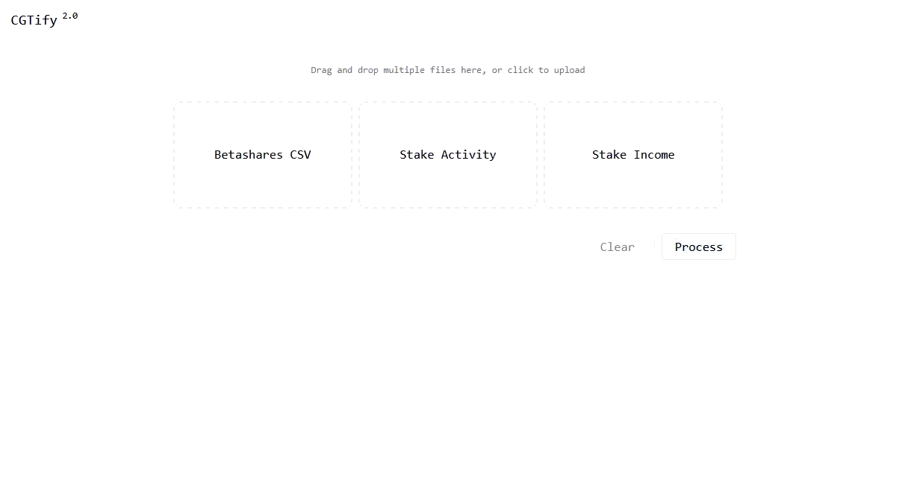

# CGT Calculator

Upload your broker trade history and get realised capital gains, cost bases, holdings and dividends, ready for tax time.



## Why
Working out capital gains from broker exports by hand is error-prone. Sells have to be matched to the right buy lots, and stock splits quietly break the cost bases.

## How it works
- **Lot matching.** Each sell is matched against buy lots by FIFO, LIFO or HIFO, which you choose. Partly used lots carry forward.
- **Split adjustment.** Lots bought before a split are rescaled (quantity × ratio, price ÷ ratio), so cost bases stay correct.
- **Multi-file upload.** Exports from several periods are normalised, merged and sorted before calculation.
- **Export.** Download the CGT, portfolio and dividend tables.

## Key design decisions
| Decision | Why | Trade-off |
|---|---|---|
| All calculation runs in the browser | Trade history is sensitive, and none of it leaves your machine | No saved history between sessions |
| Matching method is user-selectable | Different methods produce different tax outcomes | More states to test |

## Stack
SvelteKit (Svelte 5) · TypeScript · Tailwind · shadcn · Docker · nginx · Cloudflare Tunnel

## Run locally
Requires Docker. No keys needed.
```bash
docker compose -f compose.dev.yml up --build
```
Open http://localhost:8081. The sample exports in `samples/` can be uploaded to try it.

Type check:
```bash
docker compose -f compose.dev.yml exec cgt_dev_web-service pnpm check
```

## What I'd improve next
- Apply the 50% CGT discount for assets held more than 12 months
- Unit tests for the lot-matching logic
